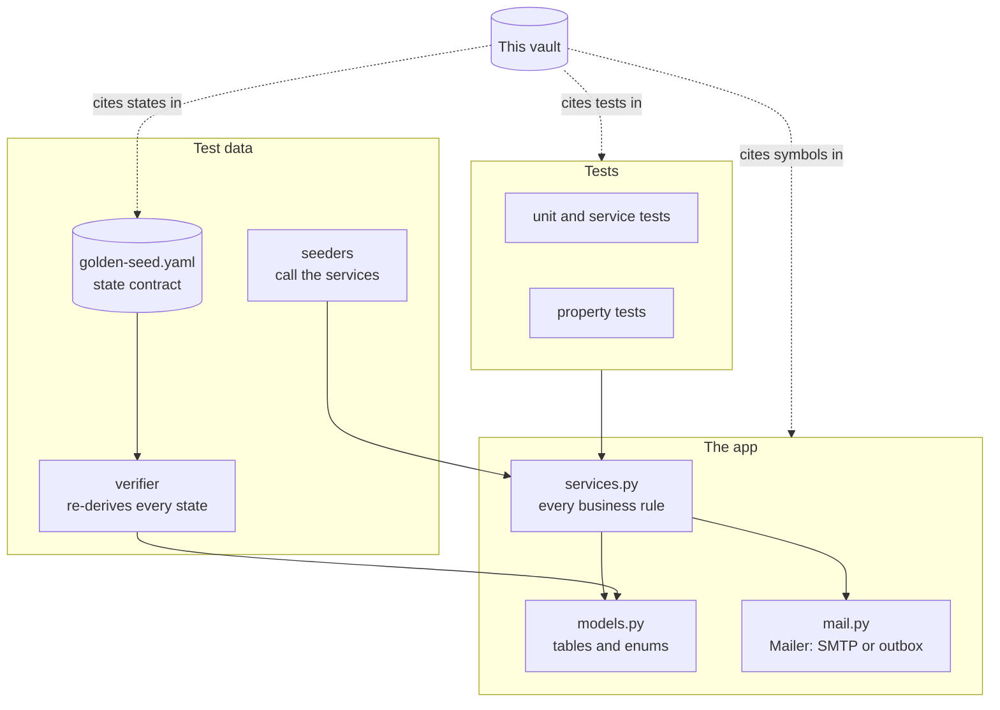

# Architecture and stack

## Stack

| Layer | Choice | Notes |
|---|---|---|
| Language | Python 3.11+ | |
| Persistence | SQLAlchemy 2.0 ORM | SQLite by default, PostgreSQL in CI and production. |
| Business rules | One service layer (`hrapp/services.py`) | Every rule lives here and only here. |
| Email | `Mailer` protocol | SMTP in production, an outbox table in tests and seeding. |
| Test data | [golden-seed](https://github.com/Abdelrahman1412/golden-seed) | Seeds a full tenant through the service layer, then proves every state with a verifier. |
| Tests | pytest, Hypothesis | Example tests, property tests, a stateful leave model. |
| CI | GitHub Actions | Push, pull request and nightly runs. |

## Layers

The dotted lines are what `qv check` holds the vault to. A rule cites a function; a test case
cites a test or a contract state; a data value cites a contract state. If any of those
disappears, the check fails.

## Test layers, lowest first

| Layer | Proves | Example here |
|---|---|---|
| unit | Pure logic with no database. | Month boundaries, date overlap. |
| service | One business rule through the service layer, with a database. | Refusing a duplicate email. |
| property | An invariant over thousands of generated inputs. | Net pay is never negative. |
| contract | A state the seeded tenant must always hold, proven by the verifier. | Every payslip reconciles. |
| api | The HTTP contract: status codes, shapes, permissions. | None: the demo app has no API. |
| e2e | A user journey through the UI. | None: the demo app has no UI. |

A test case belongs at the lowest layer that can prove it. Cases at `api` or above must say why
in their "Why this layer" column, and `qv check` fails if they don't.
