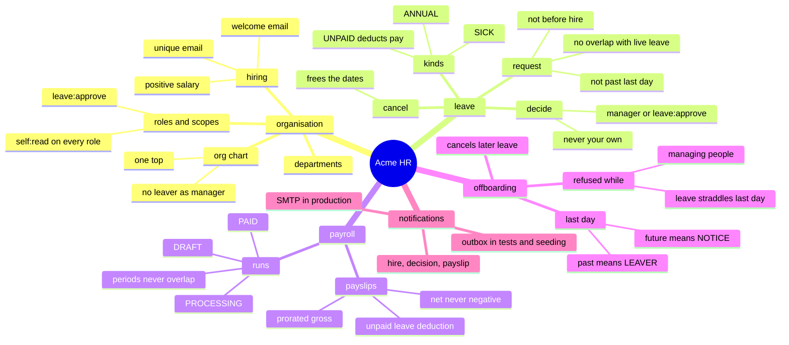
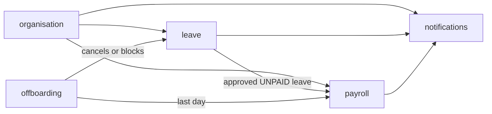

# Mind map

The whole app on one page. Start here, then open a module's spec.

## How the modules depend on each other

A change in **leave** can change **payroll** numbers. A change in **offboarding** can change both.
When a sweep flags one of these modules, re-read the modules downstream of it too.
