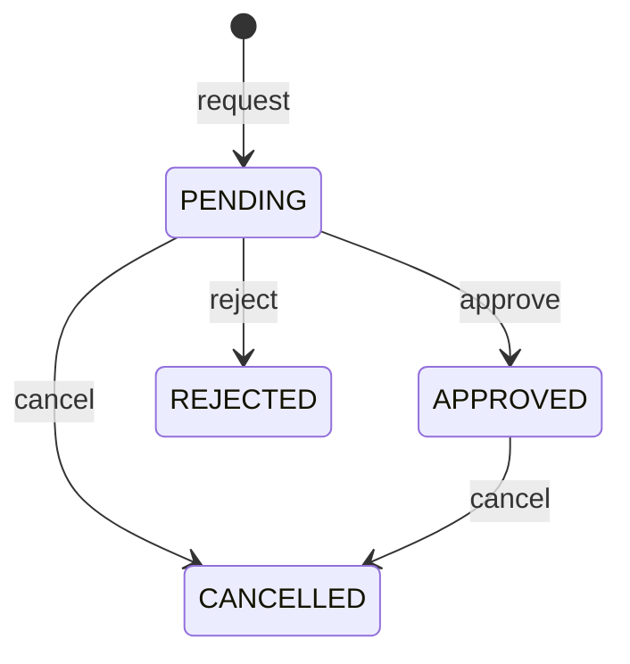

# Leave: behaviour spec

An employee requests leave; their manager, or someone holding `leave:approve`, approves or
rejects it; the employee can cancel it while it is pending or approved.

**Read with:** [test cases](../../03-Test-Cases/leave.md) ·
[data inventory](../../04-Data-Setup/leave.md) · [code map](../../01-System-Map/Code-Map.md#leave)

## Status graph

"Live" means PENDING or APPROVED. Only live requests hold dates.

## Rules

| ID | Rule | Code | Since |
|---|---|---|---|
| LV-R01 | A request that ends before it starts is refused. | `services.request_leave` | v0.1 |
| LV-R02 | A leaver cannot request leave. | `services.request_leave` | v0.1 |
| LV-R03 | Leave cannot start before the hire date. | `services.request_leave` | `44d688b` |
| LV-R04 | Leave cannot run past a last working day that has been set. | `services.request_leave` | v0.1 |
| LV-R05 | A request may not overlap any live request of the same employee, whatever its kind. Both the first and the last day count. | `services.request_leave`, `services.overlap_days` | v0.1 |
| LV-R06 | A new request is PENDING, with no approver and no decision date. | `services.request_leave`, `models.LeaveRequest` | v0.1 |
| LV-R07 | Only a PENDING request can be approved or rejected. | `services._check_decider` | v0.1 |
| LV-R08 | Nobody approves or rejects their own leave, whatever their role. | `services._check_decider` | v0.1 |
| LV-R09 | A leaver cannot decide leave. | `services._check_decider` | v0.1 |
| LV-R10 | The decider is the requester's manager, or holds the `leave:approve` scope. | `services._check_decider` | v0.1 |
| LV-R11 | A decision records the decider and the date, and emails the requester. | `services.approve_leave`, `services.reject_leave` | v0.1 |
| LV-R12 | Only a live request can be cancelled. Cancelling sends no email. | `services.cancel_leave` | v0.1 |
| LV-R13 | A cancelled or rejected request frees its dates: the same leave can be requested again. | `models.LeaveRequest` | `44d688b` |
| LV-R14 | Status changes follow the graph above and nothing else. | `services.approve_leave`, `services.reject_leave`, `services.cancel_leave`, `models.LeaveStatus` | v0.1 |
| LV-R15 | Leave kinds are ANNUAL, SICK and UNPAID. Only approved UNPAID leave changes pay (see PAY-R06). | `models.LeaveKind` | v0.1 |

## Open questions

None.

## Changelog

- 2026-11-24: release sweep `cf68fa4..e3e619d`. Added LV-R03 and LV-R13 (both fixed in
  `44d688b` after property tests found them, see TF-001 and TF-002).
- 2026-11-22: spec written from the code at `cf68fa4`.
