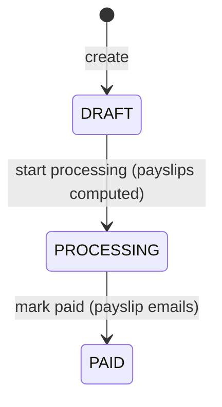

# Payroll: behaviour spec

A payroll run covers one period. Processing it computes a payslip for everyone employed in the
period; paying it notifies them. Money is in integer cents.

**Read with:** [test cases](../../03-Test-Cases/payroll.md) ·
[data inventory](../../04-Data-Setup/payroll.md) · [code map](../../01-System-Map/Code-Map.md#payroll)

## Status graph



## The payslip formula

```
days       = calendar days in the period
employed   = days between max(hire, start) and min(last day, end), both ends included
gross      = salary × employed ÷ days          (rounded down)
unpaid     = approved UNPAID leave days inside the period
deduction  = min(salary × unpaid ÷ days, gross) (rounded down)
net        = gross − deduction
```

## Rules

| ID | Rule | Code | Since |
|---|---|---|---|
| PAY-R01 | A run's period cannot end before it starts. | `services.create_payroll_run` | v0.1 |
| PAY-R02 | Run periods never overlap. | `services.create_payroll_run`, `models.PayrollRun`, `services.overlap_days` | v0.1 |
| PAY-R03 | Runs move DRAFT, then PROCESSING, then PAID, one step at a time. | `services.start_processing`, `services.mark_paid`, `models.PayrollStatus` | v0.1 |
| PAY-R04 | Processing creates one payslip for each person hired by the period's end and not gone before its start. A run with nobody in scope is refused. | `services.start_processing`, `models.Payslip` | v0.1 |
| PAY-R05 | Gross is the monthly salary prorated by calendar days employed in the period. | `services.compute_payslip` | v0.1 |
| PAY-R06 | Approved UNPAID leave is deducted per calendar day inside the period. Pending, rejected and cancelled leave is not. | `services.compute_payslip` | v0.1 |
| PAY-R07 | The deduction never exceeds gross, so net is never negative, and net = gross − deduction. | `services.compute_payslip`, `services.start_processing` | v0.1 |
| PAY-R08 | Paying a run emails every payslip holder. | `services.mark_paid` | v0.1 |
| PAY-R09 | A month's period runs from its first to its last calendar day, leap years included. | `services.month_period` | v0.1 |

## Open questions

None.

## Changelog

- 2026-11-24: release sweep `cf68fa4..e3e619d`. No rule changed; PAY-R06 and PAY-R07 gained
  property tests.
- 2026-11-22: spec written from the code at `cf68fa4`.
